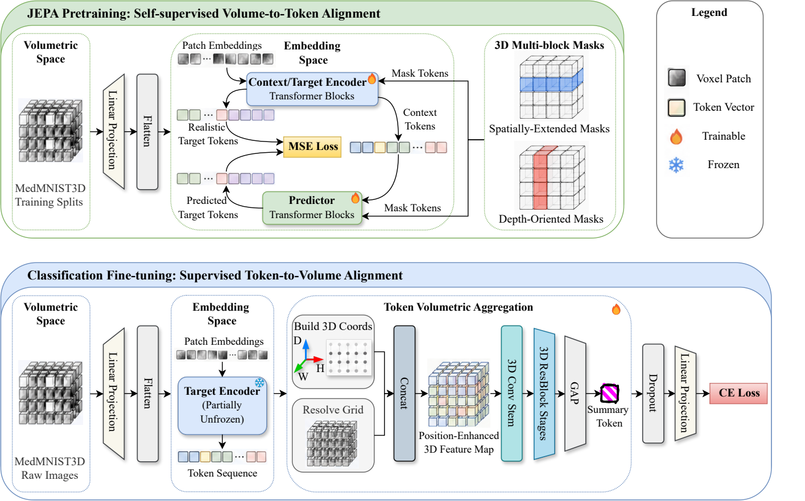
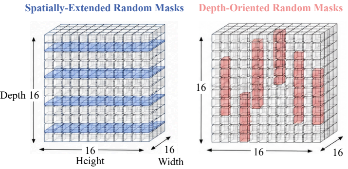

# V2VA: Volume Token Volume Alignment

[](https://huggingface.co/Herbert23H/V2VA_Pretrain_Checkpoint)

**Volume Token Volume Alignment across Embedding and Volumetric Spaces for 3D Medical
Image Classification** — accepted at **PRICAI 2026** (Pacific Rim International Conference
on Artificial Intelligence).

**Zhenghao Duan, Dongyun Lin, Weiyao Lan** — School of Aerospace Engineering, Xiamen
University, Xiamen, China.

> 📄 The official proceedings have not been published yet. This page will be updated with
the paper and DOI as soon as they are available. In the meantime, please cite the paper
using the BibTeX entry in [Citation](#citation).

Self-supervised pretraining and downstream classification for **3D medical volumes**,
built on top of [facebookresearch/jepa](https://github.com/facebookresearch/jepa) (V-JEPA).

The core idea of V2VA is to align two spaces: the encoder's *embedding space* and the
*volumetric space* of the input. JEPA-style pretraining learns this alignment in the
**volume-to-token** direction; the classification head then applies the reverse
**token-to-volume** direction. Instead of pooling all tokens into a single vector
(GAP / attentive pooling / CLS), the encoder output `[B, N, E]` is
**re-folded back into a voxel grid** `[B, E(+3), D', H', W']` and classified by a
lightweight residual 3D CNN — so the spatial arrangement of tokens is preserved all the way
to the prediction. Optional coordinate channels and a plane-agnostic cross-attention
variant are also provided.

## Method



*Overview. **Top — JEPA pretraining (self-supervised volume-to-token alignment):** a 3D ViT
encoder maps voxel patches to tokens, a predictor reconstructs the masked target tokens, and
MSE is minimised between predicted and realistic target tokens. Two complementary 3D
multi-block masking strategies are used. **Bottom — classification fine-tuning (supervised
token-to-volume alignment):** the frozen (partially unfrozen) encoder tokens are re-folded
into a 3D grid, concatenated with explicit `(D, H, W)` coordinate channels, and aggregated by
a 3D Conv stem + 3D ResBlock stages + GAP into a summary token that drives the classifier.*



*The two 3D masking strategies used during pretraining on a 16³ token grid.
**Spatially-extended masks** (blue) hide whole slabs and teach global layout, while
**depth-oriented masks** (red) hide depth-aligned columns and force the encoder to reason
along the depth axis.*

Vector versions: [`figures/paper/overview_v5.pdf`](figures/paper/overview_v5.pdf),
[`figures/paper/mask_short_v2.pdf`](figures/paper/mask_short_v2.pdf).

## Headline result

Re-folding tokens into a volume gives a large accuracy gain over standard pooling heads, at
essentially the same inference cost:

| Head | Params (M) | FLOPs (G) | Inference (ms) | Avg. AUC (%) |
| --- | --- | --- | --- | --- |
| Average pooling (GAP) | 23.63 | 11151.9 | 532.1 | 84.1 |
| Attentive pooling | 38.11 | 11307.4 | 535.6 | 84.5 |
| CLS token | 37.81 | 13009.8 | 611.6 | 84.2 |
| **Token2Volume (ours)** | **27.14** | **11673.4** | **541.1** | **92.2** |

- Params / FLOPs / latency are measured by `benchmark_heads.py` on `adrenalmnist3d_64`
  (see `experiments/benchmark_heads.csv`).
- Average AUC is taken from `figures/bubble.png` (averaged over the six MedMNIST+3D tasks).
- Accuracy/efficiency trade-off: `figures/bubble.png`
- Per-task radar comparison: `figures/radar_comparison2.pdf`
- Downstream confusion matrices (adrenal, task 1): `figures/{train,val,best_train_ep24,best_val_ep24}_task1.png`

## Repository layout

```
V2VA/
├── app/                      # pretraining entry points (pyTorch/multiprocessing launcher)
│   ├── main.py               #   python -m app.main --fname <config>
│   ├── main_stage2.py        #   stage-2 pretraining (optional)
│   └── vjepa/                #   train loops + 3D volume transforms
├── evals/                    # frozen-encoder downstream evaluation
│   ├── main.py               #   train + val
│   ├── onlytest_main.py      #   test only
│   ├── onlyeval_main.py      #   monitoring-only evaluation
│   ├── draw_main.py          #   PCA / Grad-CAM figures
│   └── mri_classification_frozen/
├── src/
│   ├── models/               # ViT / Swin backbones, predictor, attentive pooler + TokenToVolume3DClassifier
│   ├── masks/                # 3D multi-block + random-tube masking
│   ├── datasets/             # MedMNIST+3D / MRI datasets and data managers
│   └── utils/
├── configs/                  # YAML configs (paths are relative to the repository root)
├── experiments/              # run outputs (git-ignored; see experiments/README.md)
├── figures/                  # result figures (figures/paper/ = paper figures, PDF + PNG)
├── tools/medmnist3d/         # dataset inspection / mask visualisation utilities
├── data/                     # datasets (git-ignored; see data/README.md)
├── benchmark_heads.py        # params / FLOPs / latency benchmark for all heads
├── run_draw_all.sh           # batch all draw configs
└── useful_cmd_medmnist.sh    # command cheatsheet
```

## Installation

```bash
git clone https://github.com/Herbert23H/V2VA-Volume-Token-Volume-Alignment.git
cd V2VA-Volume-Token-Volume-Alignment

conda create -n v2va python=3.9 -y
conda activate v2va
pip install -r requirements.txt
```

`pip install -e .` also works — `setup.py` reads `requirements.txt` from the repository root.

## Data

No dataset is shipped with this repository. Put the MedMNIST+3D archives under
`data/medmnist3d/` — the expected layout and the exact `.npz` key names are documented in
[`data/README.md`](data/README.md), and you can validate your copy with:

```bash
python tools/medmnist3d/check_data.py
```

Visualise the 3D masking used during pretraining:

```bash
python tools/medmnist3d/plot_medmnist_mask_3d_demo.py --data_dir data --out_dir figures/mask_3d_demo
```

## Usage

All commands are run from the repository root.

```bash
# 1) 3D self-supervised pretraining  (ViT-B/16, MedMNIST+3D 64^3)
python -m app.main \
  --fname configs/pretrain/vitb16_384_medmnist_plus_3d_fine-grain.yaml \
  --devices cuda:0

# 2) downstream evaluation with a frozen encoder (train + val)
python -m evals.main \
  --fname configs/evals/fine-grain-val/vitb16_384_medmnist_plus_3d_ad_sota.yaml \
  --devices cuda:0

# 3) test split only (writes confusion matrices)
python -m evals.onlytest_main \
  --fname configs/evals/fine-grain-val/vitb16_384_medmnist_plus_3d_ad_sota_test.yaml \
  --devices cuda:0

# 4) head benchmark: params / FLOPs / latency (supply your own head configs)
python benchmark_heads.py --config-dir configs/evals/head

# 5) figures
python -m evals.draw_main --fname <draw-config.yaml> --device cuda:0
CONFIG_DIR=<draw-configs-dir> bash run_draw_all.sh cuda:0
```

### Selecting the classification head

The head is configured under `optimization` in the eval YAML:

| Key | Effect |
| --- | --- |
| `use_token_3d_cnn_head: true` | **Token2Volume** — re-fold `[B, N, E]` to a voxel grid, classify with a residual 3D CNN |
| `token_3d_use_coords` | append normalised `(x, y, z)` coordinate channels to the grid |
| `token_3d_stem_channels`, `token_3d_stage_channels`, `token_3d_stage_depths`, `token_3d_stage_strides` | 3D CNN width / depth |
| `token_3d_grid_size` | force a fixed token grid `(Dr, Hr, Wr)`; `null` infers it from the input volume and patch size |
| `use_plane_path` / `use_plane_cross_attention` | plane-agnostic cross-attention + plane-gate pooling instead of the single-path head |
| (all false) | fall back to `MultiHeadAttentiveClassifier` |

### Environment variables

Every path is relative and overridable, so the code runs from any clone:

| Variable | Default | Purpose |
| --- | --- | --- |
| `V2VA_REPO_ROOT` | auto-detected | repository root |
| `V2VA_DATA_ROOT` | `<repo>/data` | dataset tree |
| `V2VA_EXP_ROOT` | `<repo>/experiments` | run outputs |
| `V2VA_KNEE_DICOM_ROOT` / `V2VA_KNEE_CACHE_DIR` / `V2VA_KNEE_LABEL_XLSX` | `data/mri/...` | private 5-modality knee MRI pipeline |
| `V2VA_MRI_HEALTHY_NII_DIR` | `data/mri/healthy_nii` | private MRI pretraining corpus |
| `V2VA_NII_DEBUG_DIR` | `outputs/nii_debug` | optional NIfTI dumps of transformed volumes |
| `V2VA_ONLYEVAL_OUTDIR` | `experiments/onlyeval` | `onlyeval_main` output dir |
| `V2VA_LOSS_CSV`, `V2VA_LOSS_PNG` | `experiments/jepa_r0.csv`, `figures/loss_curve.png` | loss-curve plotting |
| `V2VA_RADAR_OUT` | `figures/radar_comparison.pdf` | radar figure output |

### Pretrained weights

The pretrained encoder (`jepa-latest.pth.tar`, 1.5 GB) is hosted on the Hugging Face Hub:

**👉 [Herbert23H/V2VA_Pretrain_Checkpoint](https://huggingface.co/Herbert23H/V2VA_Pretrain_Checkpoint)**

```bash
# place it exactly where the eval configs expect it
hf download Herbert23H/V2VA_Pretrain_Checkpoint jepa-latest.pth.tar \
  --local-dir experiments/ViTB_medmnist3d_pretrain_64_fine-grain
```

SHA-256 of the checkpoint (equals its LFS OID):

```
a731d61d67faf06c094b3ba002054103ce5c92c45568577a255030ff16307a5b
```

The checkpoint is a dict with the keys `epoch, encoder, predictor, target_encoder, opt,
scaler`; the downstream code uses `target_encoder`. Alternatively point `pretrain.folder` in
the eval configs at wherever you keep the file. See
[`experiments/README.md`](experiments/README.md).

## Notes and limitations

- The paper's ablation configs (`configs/evals/fine-grain-ablation/**`,
  `configs/evals/fine-grain/**`) are intentionally **not** released. `benchmark_heads.py`
  takes `--config-dir` and `run_draw_all.sh` takes `CONFIG_DIR`, so point them at your own
  head / draw configs.
- The 5-modality knee MRI / MRNet pipelines use non-public clinical data and are therefore
  **not reproducible** from this repository. They are included because the same
  Token2Volume head is used there.
- Upstream configs unrelated to 3D volumes were removed; see [`NOTICE.md`](NOTICE.md) for the
  complete list of modifications.

## License and acknowledgement

This project is a derivative work of
[facebookresearch/jepa](https://github.com/facebookresearch/jepa)
(Copyright © Meta Platforms, Inc. and affiliates), which is licensed under
**CC BY-NC 4.0**. This repository is therefore distributed under the same license —
see [`LICENSE`](LICENSE) and [`NOTICE.md`](NOTICE.md). **Commercial use is not permitted.**
The original upstream README is preserved at [`docs/JEPA_README.md`](docs/JEPA_README.md).

## Citation

If you use this code, please cite the paper (accepted at PRICAI 2026; the official
proceedings are not published yet, so page numbers and DOI are still unknown):

```bibtex
@inproceedings{duan2026v2va,
  title     = {V2VA: Volume Token Volume Alignment across Embedding and Volumetric Spaces for 3D Medical Image Classification},
  author    = {Duan, Zhenghao and Lin, Dongyun and Lan, Weiyao},
  booktitle = {Pacific Rim International Conference on Artificial Intelligence (PRICAI)},
  year      = {2026},
  note      = {Accepted; official proceedings not yet published}
}
```

Until the proceedings appear, the code itself can also be cited as:

```bibtex
@software{duan2026v2vacode,
  title  = {V2VA: Volume Token Volume Alignment},
  author = {Duan, Zhenghao and Lin, Dongyun and Lan, Weiyao},
  year   = {2026},
  url    = {https://github.com/Herbert23H/V2VA-Volume-Token-Volume-Alignment}
}
```

Please also cite the upstream V-JEPA work and MedMNIST.
